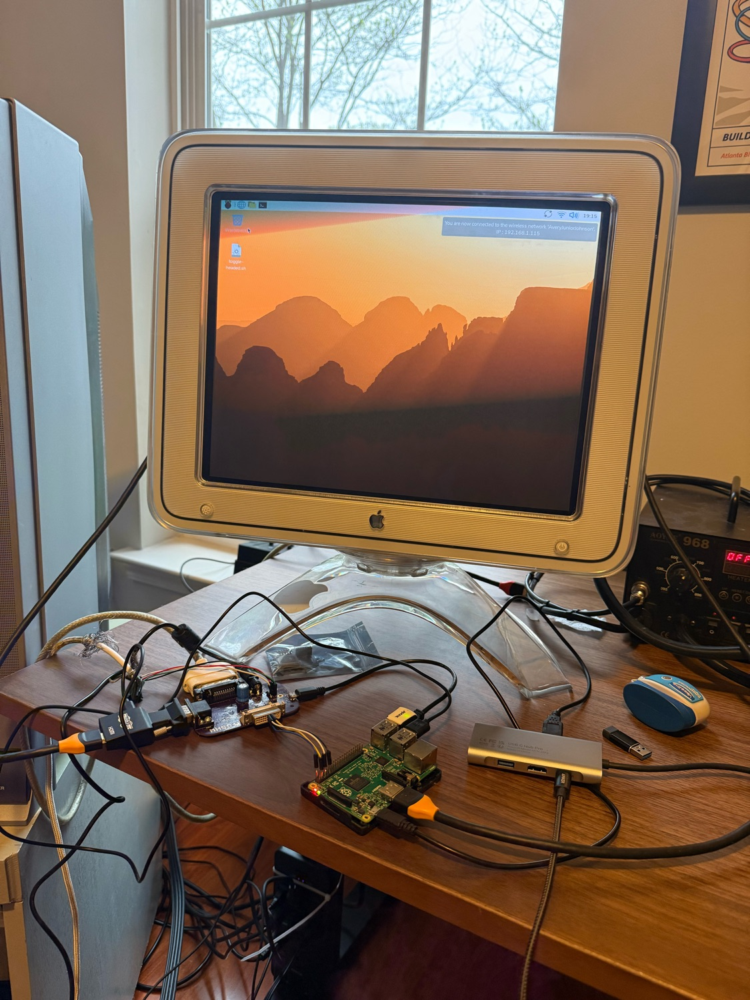
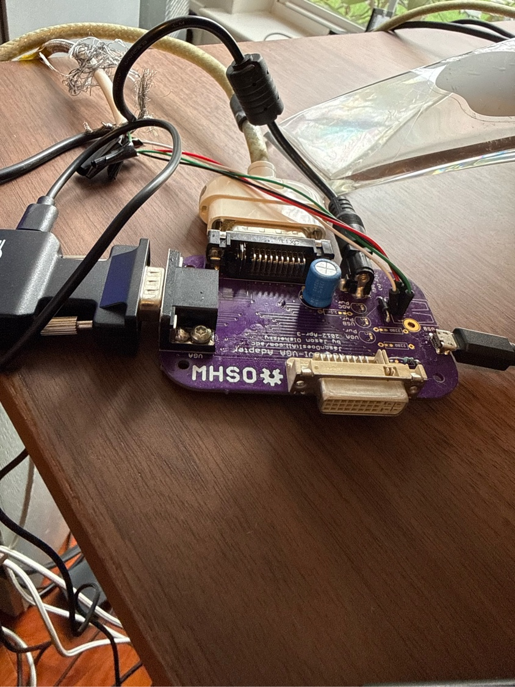

# ADC CRT Control

Power, geometry and calibration control for the Apple Studio Display 17" CRT (ADC), on modern hosts.

Without an old Mac that has an ADC port, the 17" CRT Studio Display has no power control at all: an adapter gets a picture onto it, but nothing can switch it on or off. These tools fix that. They also give you the monitor's geometry and calibration controls (contrast, size, phase, pincushion, keystone, rotation, convergence, degauss, save to NVRAM) from Linux, including a Raspberry Pi, and from an Apple Silicon Mac.

Everything goes through Jason Olshefsky's ADC adapter board, which this project calls the Jason "Does It All" adapter.



## Pick your host

| Host | Folder | What you get |
|---|---|---|
| **Linux**: Raspberry Pi (Pi 2B tested, Raspberry Pi OS with labwc) and desktop Linux, including CachyOS/Arch | [`linux/`](linux/) | GTK GUI, the `adc-crt` command-line tool, power-on at boot, and the monitor's front button opens and closes the GUI |
| **Apple Silicon Mac** (macOS 13+) | [`mac/ADCControl/`](mac/ADCControl/) | SwiftUI app, the `adcctl` diagnostic CLI, m1ddc-style DDC power writes, and resolution switching across Apple's OEM timings |

### Linux quick start

Wire the adapter first (see [docs/hardware.md](docs/hardware.md)). Then:

```bash
# Raspberry Pi (Raspberry Pi OS)
sudo raspi-config nonint do_i2c 0       # enable the GPIO I2C bus
make -C linux deb && sudo apt install ./linux/dist/adc-crt-control_3.0.0_all.deb
adc-crt doctor                          # checks every link and prints a fix for anything wrong
```

```bash
# CachyOS / Arch
cd linux/packaging/arch && makepkg -si  # then follow the next steps it prints
adc-crt doctor
```

After that, `adc-crt power toggle` switches the monitor, and `adc-crt gui` opens the calibration window. Nothing runs as root except the boot-time power-on service. Installing the 3.0 package on a Pi replaces the old `pi-adc-control` 2.x package. Full install and usage notes are in [linux/README.md](linux/README.md).

### Mac quick start

```bash
cd mac/ADCControl
swift run adcctl self-test              # offline check of the protocol constants
swift run adcctl power read             # 1 = on, 2 = sleep, 4 = off
make app                                # builds and ad-hoc signs dist/ADC CRT Control.app
open "dist/ADC CRT Control.app"
```

The app is deliberately unsandboxed and only ad-hoc signed, because direct HID and DDC access require that. Details and the full diagnostic command list are in [mac/ADCControl/README.md](mac/ADCControl/README.md).

## How it works

The monitor offers two ways in, and neither one can do the whole job:

- **USB HID** (`05ac:9213`, through the adapter's USB port) reads the monitor's state and sets every geometry control, but the power state (code `0xD6`) is **read-only** there.
- **DDC/CI** (I2C address `0x37`, over the display cable's DDC lines) can **set** the power state (VCP `0xD6`: 1 = on, 4 = off), but can't read it back.

So both implementations do the same thing: **read the power state over HID, then write the change over DDC.** Only the DDC transport differs. Linux uses the kernel's `/dev/i2c-N` interface, either on a Pi's GPIO bus or on the graphics card's own connector bus. The Mac uses Apple Silicon's IOAVService. The byte-level protocol and the shared control table are in [docs/protocol.md](docs/protocol.md).

## Hardware

Adapter, Pi wiring, desktop and Mac cabling, and the model-number question are covered in [docs/hardware.md](docs/hardware.md).



## Older Pi-only version

The original Pi-only layout (v2.x: `crt_backend.py`, `usbmonctl`, `i2ctransfer`, a sudoers file) is preserved at git tag `pi-v2.1`.

## Credits

This project stands on other people's reverse-engineering. The full list, with what was taken from each, is in [CREDITS.md](CREDITS.md):

- **[GUI-for-apple-studio-17-ADC](https://github.com/mega-calibrator/GUI-for-apple-studio-17-ADC)** by mega-calibrator, with agfa. This Windows GUI is where the project started, and the 11 geometry controls and the degauss, save and refresh-rate codes follow its table.
- **[usbmonctl](https://github.com/ondrej-zary/usbmonctl)** by Ondrej Zary. Its Apple control table documents `0xD6` as a read-only power state, and that is why power is written over DDC. The v2.x Pi version used it for all HID access.
- **[monitorcontrol](https://github.com/newAM/monitorcontrol)** by Alex Martens (newAM). This was the reference for the DDC/CI Set VCP packet.
- **[m1ddc](https://github.com/waydabber/m1ddc)** by waydabber. The Mac's Apple Silicon DDC write path is adapted from it.
- **[ddcutil](https://github.com/rockowitz/ddcutil)** by Sanford Rockowitz. The Linux udev rule that gives the desktop user access to the graphics card's DDC buses follows its approach.
- **[Apple Display Connector Adapter Board](https://jasondoesitall.com/adc/)** by Jason Olshefsky. This is open-source hardware, and the whole project is built around it.

## License

MIT; see [LICENSE](LICENSE). The m1ddc-derived code in `mac/ADCControl/Sources/ADCMonitorCore/MacDDCPowerTransport.swift` keeps m1ddc's MIT notice, which is reproduced in [CREDITS.md](CREDITS.md). Two kinds of data here come from Apple: the monitor's EDID and the macOS display-override data that the Mac override profiles start from. Those remain Apple's.

This project is not affiliated with or endorsed by Apple.
