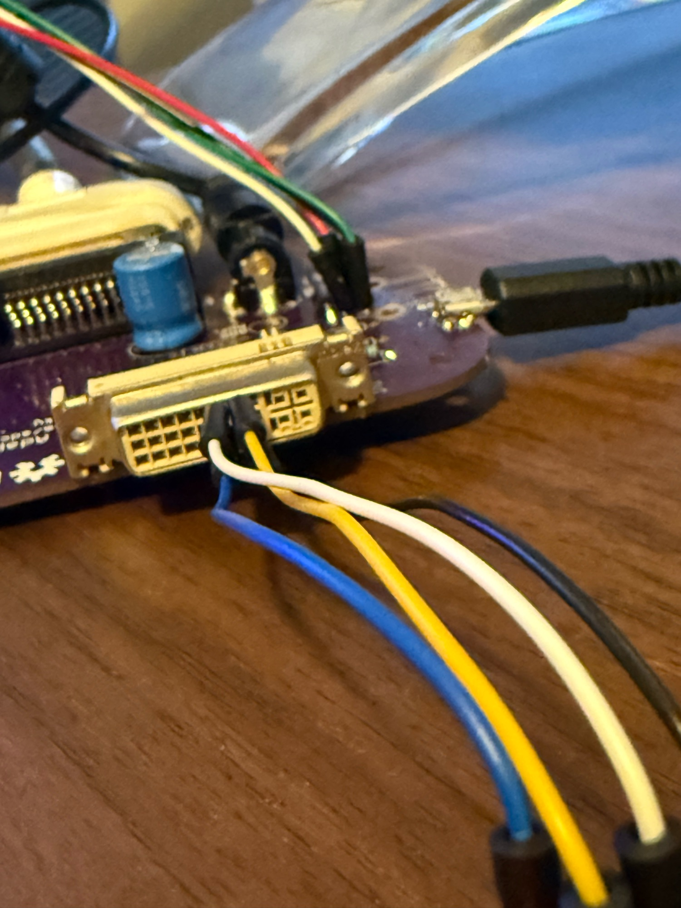

# Hardware

## The monitor

This is the Apple Studio Display 17" CRT with an ADC (Apple Display Connector) cable. This repository calls it **M7768**, and so do mega-calibrator's GUI and crtdatabase. Apple's own [technical specifications page](https://support.apple.com/en-us/112524) lists the 17" CRT Studio Display as **M7770**. Both numbers refer to this monitor family. Software identifies it by its IDs, not by model number:

- USB HID device `05ac:9213`
- EDID manufacturer `0x0610` ("APP"), product `0x9213`

## The adapter

The monitor's ADC plug carries video, DDC, USB and power in a single connector. To use it with anything other than an old ADC-equipped Mac, you need an adapter. This project is built around Jason Olshefsky's **Apple Display Connector Adapter Board** (<https://jasondoesitall.com/adc/>), which the rest of the docs call the Jason "Does It All" adapter. It is open-source hardware with published Gerber files. The board takes the monitor's ADC plug and provides:

- DVI, plus an optional VGA connection
- USB
- a DC power input for the monitor

Power the monitor as described on Jason's page.


Every host needs two links to the monitor:

1. **USB**: the adapter's USB port goes to the host. This carries the HID interface (`05ac:9213`) used to read state and adjust geometry.
2. **DDC**: the monitor's I2C lines (DDC/CI at `0x37`, EDID EEPROM at `0x50`) must reach the host. This is the only way to switch power.

## Raspberry Pi

On the Pi, DDC is hand-wired from the Pi's GPIO I2C bus 1 to the DVI port on the adapter. Four jumper wires are enough.

| Pi Pin | Pi Function | DVI Pin | DVI Function |
|--------|-------------|---------|--------------|
| Pin 2 | 5V | Pin 14 | +5V Power |
| Pin 3 | SDA1 | Pin 7 | DDC Data |
| Pin 5 | SCL1 | Pin 6 | DDC Clock |
| Pin 9 | GND | Pin 15 | DDC Ground |

In short: Pin 2 → DVI 14 (5V), Pin 3 → DVI 7 (SDA), Pin 5 → DVI 6 (SCL), Pin 9 → DVI 15 (GND).

```
        DVI-I Female — front face
        ─────────────────────────────────────────
 Row 1:  1    2    3    4    5   [6]  [7]   8
                                 SCL  SDA

 Row 2:  9   10   11   12   13  [14] [15]  16
                                 5V   GND
```



**Video:** the DVI port is taken by the I2C wires, so video goes out the adapter's **VGA port**. Feed it from the Pi's HDMI output with an HDMI-to-VGA adapter.

**USB:** connect the adapter's USB port to one of the Pi's USB ports.

### Enable I2C and check the wiring

```bash
sudo raspi-config nonint do_i2c 0   # enable the GPIO I2C bus (/dev/i2c-1)
sudo apt install -y i2c-tools       # only needed for i2cdetect
sudo i2cdetect -y 1
```

You should see `37` (the DDC/CI controller) and `50` (the EDID EEPROM). If either is missing, check the wiring.

Once the package is installed, `adc-crt doctor` runs the same check and more. It reads the EDID on bus 1, confirms it is the Studio Display, and tells you if your user needs to join the `i2c` group (`sudo usermod -aG i2c $USER`, then log out and back in).

## Desktop Linux

On a desktop, DDC goes over the graphics card's own display connector, so no jumper wires are needed. This is the same idea the Mac version uses. It does depend on the cabling. **The DDC lines of the GPU connector you use must reach the monitor through the adapter.** A common setup is a DisplayPort- or HDMI-to-VGA adapter into the Jason board. Many such adapters pass DDC through, but not all do.

To check, run `adc-crt doctor` or `adc-crt ddc buses`. The tool reads each connector's EDID from `/sys/class/drm/` and only uses a connector bus whose EDID identifies the Studio Display. A working path shows up with a source like `drm:card0-DP-1` and a verified EDID. If no connector shows the Studio Display's EDID, the cable or adapter isn't passing DDC.

The tool never probes any other I2C bus. A desktop's SMBus has the RAM's SPD EEPROMs at address `0x50`, and those are left alone.

**Fallback:** use a USB-to-I2C adapter, wired to the Jason board's DVI pins exactly like the Pi above (SDA → 7, SCL → 6, GND → 15, and 5V → 14 if the adapter provides it). Then tell `adc-crt` which bus it is, because the tool won't guess. Any of these works:

- pass `--bus N` on the command line
- set the `ADC_CRT_I2C_BUS` environment variable
- put `[ddc] bus = N` in `~/.config/adc-crt-control/config.ini` or `/etc/adc-crt-control.conf`

## Apple Silicon Mac

The Mac sends DDC over its own display output, through IOAVService. That means the same rule applies as on a desktop: whatever adapter takes the Mac's video out to the Jason board must pass DDC. `swift run adcctl ddc list` shows whether the Studio Display was found and whether it has an AV service for DDC. The adapter's USB port goes to the Mac for HID; check it with `swift run adcctl hid list`. The Mac tools refuse to act on the built-in MacBook panel and only target an external `0610:9213` display.

## Warning: powering off can leave a Pi headless

When the CRT is the only screen, powering it off blanks everything, including the cursor you would use to turn it back on. On a Raspberry Pi it can be worse. **The Pi may drop its HDMI output and go headless**, and you then need to restart the graphical session.

That is why the GUI's power-off has a 5-second countdown you can cancel. On a Pi it helps to have SSH access, so you can run `adc-crt power on` from another machine.
